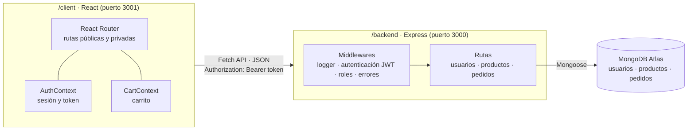

<div align="center">

# Mueblería Hermanos Jota

### E-commerce MERN · React + Node.js/Express + MongoDB Atlas

Aplicación full stack de un catálogo de muebles con autenticación de usuarios, carrito de compras, registro de pedidos y panel de administración, desarrollada como entrega final de los Sprints 7 y 8 del curso de **Desarrollo Full Stack**.


[Descripción](#descripción) •
[Enlaces](#enlaces-públicos) •
[Arquitectura](#arquitectura) •
[Instalación](#instalación-y-ejecución) •
[Funcionalidades](#funcionalidades) •
[API](#documentación-de-la-api) •
[Seguridad](#seguridad) •
[Decisiones](#decisiones-de-arquitectura)

</div>

---

## Descripción

**Mueblería Hermanos Jota** es un e-commerce construido con el stack MERN (MongoDB, Express, React y Node.js). Es un **monorepo** que reúne en un mismo repositorio:

- **`/client`**: frontend en React, creado con Create React App.
- **`/backend`**: API REST con Node.js y Express, con persistencia en MongoDB Atlas mediante Mongoose.

Los usuarios pueden explorar el catálogo, ver el detalle de cada producto, registrarse, iniciar sesión, armar un carrito, finalizar una compra y consultar su historial de pedidos. Los administradores, además, gestionan el catálogo (crear, editar y eliminar productos).

---

## Integrantes

| Integrante |
|:-----------|
| **Lautaro Iturrieta** |
| **Evelyn Noya Fraga** |

---

## Enlaces públicos

| Recurso | Plataforma | Enlace |
|:--------|:-----------|:-------|
| Repositorio | GitHub | [github.com/lauta201/muebleria-hermanos-jota](https://github.com/lauta201/muebleria-hermanos-jota) |
| Frontend | Vercel | [muebleria-hermanos-jota-client.vercel.app](https://muebleria-hermanos-jota-client.vercel.app) |
| Backend | Render | [muebleria-hermanos-jota-scrd.onrender.com](https://muebleria-hermanos-jota-scrd.onrender.com) |
| API de productos | Render | [/api/productos](https://muebleria-hermanos-jota-scrd.onrender.com/api/productos) |

La aplicación se encuentra desplegada y se verificó el inicio de sesión desde el frontend público, conectado al backend en Render y a la base de datos en MongoDB Atlas.

> El backend se aloja en el plan gratuito de Render: tras un período de inactividad, la primera respuesta puede demorar unos segundos.

---

## Tecnologías

| Frontend (`/client`) | Backend (`/backend`) | Despliegue |
|:---------------------|:---------------------|:-----------|
| React 19 | Node.js | Vercel (frontend) |
| JavaScript | Express 5 | Render (backend) |
| React Router | MongoDB Atlas | MongoDB Atlas (base de datos) |
| React Context API | Mongoose | |
| HTML5 y CSS3 | bcrypt | |
| Fetch API | JSON Web Tokens (JWT) | |
| Create React App | Middlewares de autenticación y autorización | |
| | dotenv | |

---

## Arquitectura

El flujo completo es: **React + React Router + Context API → API REST Express → Mongoose → MongoDB Atlas**.



| Aplicación | Carpeta | Puerto local | Rol |
|:-----------|:--------|:------------:|:----|
| Frontend | `/client` | `3001` | Interfaz de usuario en React |
| Backend | `/backend` | `3000` | API REST: usuarios, productos y pedidos |
| Base de datos | — | — | MongoDB Atlas, accedida mediante Mongoose |

### Componentes principales

- **`AuthContext`**: contexto global de autenticación. Gestiona el usuario autenticado y el token JWT, recupera la sesión a partir del token guardado en el almacenamiento local, y expone las funciones `login` y `logout`. El registro de usuarios se realiza desde `RegisterPage`. La navegación se adapta según haya o no un usuario autenticado y protege las rutas privadas.
- **`CartContext`**: contexto global del carrito. Permite agregar y quitar productos, modificar cantidades y calcular totales, y persiste el estado en `localStorage`.
- **Autenticación con JWT**: al iniciar sesión, el backend emite un token firmado. El cliente lo envía en la cabecera `Authorization: Bearer <token>` y el backend lo verifica en cada ruta protegida.
- **Middlewares de autorización**: verifican el token y, en las operaciones administrativas, comprueban además que el usuario tenga rol de administrador.
- **Modelos**: usuarios, productos y pedidos, definidos con Mongoose.
- **Rutas de la API**: agrupadas por recurso (`/api/usuarios`, `/api/productos`, `/api/pedidos`).

### Estructura de carpetas

```text
/
├── client/                         # Frontend React
│   ├── public/
│   └── src/
│       ├── components/             # Navbar, Footer, ProductCard, ProductList,
│       │                           # ProductDetail, ProductForm, ContactForm, etc.
│       ├── context/                # AuthContext y CartContext
│       ├── pages/                  # Inicio, catálogo, detalle, contacto, carrito,
│       │                           # login/registro, administración, perfil y pedidos
│       ├── App.js
│       └── index.js
│
└── backend/                        # API REST con Express
    ├── config/
    │   └── db.js                   # Conexión a MongoDB Atlas
    ├── models/                     # Modelos Mongoose: usuarios, productos y pedidos
    ├── middlewares/                # Logger, autenticación/autorización, 404 y errores
    ├── controllers/                # Lógica de usuarios, productos y pedidos
    ├── routes/                     # Rutas de usuarios, productos y pedidos
    ├── index.js
    └── package.json
```

---

## Instalación y ejecución

> El frontend y el backend se ejecutan en **terminales separadas**. Para usar la aplicación, ambos deben estar en funcionamiento.

### Requisitos

- Node.js `>= 18`
- npm `>= 9`
- Una base de datos en MongoDB Atlas y su cadena de conexión

### 1. Backend (puerto `3000`)

En la **Terminal 1**:

```bash
cd backend
npm install
```

Creá un archivo `.env` dentro de `/backend`:

```env
PORT=3000
MONGO_URI=tu_cadena_de_conexion
JWT_SECRET=un_secreto_largo_y_aleatorio
```

Iniciá el servidor:

```bash
npm run dev     # desarrollo, con Nodemon
# o bien
npm start       # ejecución directa con Node
```

### 2. Frontend (puerto `3001`)

En la **Terminal 2**:

```bash
cd client
npm install
```

Creá un archivo `.env` dentro de `/client`:

```env
REACT_APP_API_URL=http://localhost:3000/api/productos
```

Iniciá la aplicación:

```bash
npm start
```

### Variables de entorno

| Aplicación | Variable | Descripción |
|:-----------|:---------|:------------|
| Backend | `PORT` | Puerto del servidor |
| Backend | `MONGO_URI` | Cadena de conexión a MongoDB Atlas |
| Backend | `JWT_SECRET` | Secreto utilizado para firmar y verificar los JWT |
| Frontend | `REACT_APP_API_URL` | URL del endpoint de productos de la API |

> No subas credenciales reales al repositorio: los archivos `.env` deben mantenerse fuera del control de versiones.

---

## Funcionalidades

### Catálogo y administración

- Catálogo obtenido desde MongoDB mediante una API REST.
- Productos destacados.
- Detalle individual de cada producto.
- Operaciones CRUD de productos.
- Acceso administrativo controlado por roles.
- Operaciones administrativas protegidas mediante JWT.

### Autenticación

- Registro de usuarios.
- Almacenamiento de contraseñas con hashing mediante bcrypt.
- Inicio de sesión.
- Generación y verificación de JWT.
- Persistencia de la sesión mediante React Context y almacenamiento local del token.
- Cierre de sesión.
- Navegación condicional según el usuario autenticado.
- Protección de rutas privadas.

### Carrito de compras

- Estado global mediante React Context API.
- Agregar y quitar productos.
- Modificar cantidades.
- Cálculo de totales.
- Persistencia del carrito en `localStorage`.
- Finalización de compra para usuarios autenticados.
- Vaciado automático del carrito luego de registrar correctamente el pedido.

### Pedidos

- Registro de pedidos mediante la API.
- Asociación de cada pedido con el usuario autenticado.
- Verificación de precios y stock desde el backend.
- Actualización del inventario.
- Protección frente a solicitudes de compra duplicadas mediante idempotencia.
- Historial de compras del usuario.

### Perfil

- Datos de la cuenta autenticada.
- Historial de pedidos con su estado y detalle.
- Rutas `/perfil` y `/mis-pedidos`.
- Redirección al login cuando no existe una sesión válida.

### Otras características del frontend

- Manejo de estados de carga, error y éxito al consumir la API.
- Navegación con React Router.
- Formulario de contacto controlado mediante `useState`.
- Diseño responsive.

---

## Documentación de la API

**URL base local:** `http://localhost:3000` · **URL publicada:** `https://muebleria-hermanos-jota-scrd.onrender.com`

### Autenticación en las solicitudes

Las rutas protegidas requieren el token JWT obtenido al iniciar sesión, enviado en la cabecera `Authorization`:

```http
Authorization: Bearer <token>
```

### Endpoints

| Método | Endpoint | Función | Acceso |
|:------:|:---------|:--------|:-------|
| `POST` | `/api/usuarios/registro` | Registra un nuevo usuario | Pública |
| `POST` | `/api/usuarios/login` | Inicia sesión y devuelve un JWT | Pública |
| `GET` | `/api/usuarios/perfil` | Devuelve los datos del usuario autenticado | Requiere JWT |
| `GET` | `/api/productos` | Lista todos los productos | Pública |
| `GET` | `/api/productos/:id` | Obtiene un producto por su `_id` | Pública |
| `POST` | `/api/productos` | Crea un producto | Requiere JWT y rol de administrador |
| `PUT` | `/api/productos/:id` | Actualiza un producto | Requiere JWT y rol de administrador |
| `DELETE` | `/api/productos/:id` | Elimina un producto | Requiere JWT y rol de administrador |
| `POST` | `/api/pedidos` | Registra un pedido del usuario autenticado | Requiere JWT |
| `GET` | `/api/pedidos/mis-pedidos` | Lista los pedidos del usuario autenticado | Requiere JWT |

> Los recursos utilizan el identificador `_id` generado por MongoDB, no identificadores numéricos.

### Ejemplos

```bash
# Listar productos (público)
curl http://localhost:3000/api/productos

# Iniciar sesión
curl -X POST http://localhost:3000/api/usuarios/login \
  -H "Content-Type: application/json" \
  -d '{ "email": "usuario@ejemplo.com", "password": "tu_contrasena" }'

# Consultar el perfil con el token recibido
curl http://localhost:3000/api/usuarios/perfil \
  -H "Authorization: Bearer <token>"
```

> Los nombres exactos de los campos del cuerpo de cada solicitud (registro, login y pedidos) y el formato de cada respuesta están definidos en los controladores del backend.

### Códigos de error habituales

| Código | Situación |
|:------:|:----------|
| `400` | Datos inválidos o identificador con formato incorrecto |
| `401` | Token ausente, inválido o vencido |
| `403` | Usuario autenticado sin permisos de administrador |
| `404` | Recurso o ruta inexistente |

---

## Seguridad

Medidas efectivamente implementadas en el proyecto:

- **Hashing de contraseñas**: las contraseñas se almacenan hasheadas con bcrypt; no se guardan en texto plano.
- **Autenticación con JWT**: el backend emite tokens firmados con `JWT_SECRET` y los verifica en las rutas protegidas.
- **Autorización por roles**: las operaciones de creación, edición y eliminación de productos solo están disponibles para usuarios con rol de administrador.
- **Protección de endpoints**: las rutas de perfil y pedidos exigen un usuario autenticado, y cada usuario accede únicamente a sus propios pedidos.
- **Variables de entorno**: la cadena de conexión y el secreto de firma se definen en archivos `.env` mediante dotenv, fuera del código y del control de versiones.
- **Validación de datos y stock**: el backend verifica los datos recibidos, los precios y el stock disponible al registrar un pedido, sin confiar en los valores enviados por el cliente.
- **Idempotencia en pedidos**: el registro de pedidos incorpora protección frente a solicitudes de compra duplicadas.

> Este es un proyecto académico. Las medidas descriptas corresponden al alcance del curso y no constituyen una auditoría de seguridad completa.

---

## Decisiones de arquitectura

| Decisión | Detalle |
|:---------|:--------|
| **Monorepo** | `/client` y `/backend` conviven en un mismo repositorio como aplicaciones separadas, cada una con su propio `package.json`, instalación y puerto. |
| **Persistencia en MongoDB Atlas** | Usuarios, productos y pedidos se almacenan en MongoDB Atlas y se acceden mediante modelos de Mongoose. |
| **Autenticación stateless con JWT** | El servidor no guarda sesiones: el cliente envía el token en cada solicitud protegida. |
| **Estado global con Context API** | `AuthContext` gestiona la sesión y `CartContext` el carrito, sin librerías adicionales de estado. |
| **Autorización por roles** | Un middleware distingue entre usuarios comunes y administradores para proteger las operaciones sobre el catálogo. |
| **Validación en el backend** | Los precios y el stock se verifican en el servidor al registrar un pedido. |
| **Idempotencia en pedidos** | Evita que una misma solicitud de compra genere pedidos duplicados. |
| **Middlewares dedicados** | Logging, autenticación y autorización, 404 y manejo centralizado de errores, cada uno en su propio archivo. |
| **ES Modules** | El backend utiliza ES Modules. |
| **Configuración por variables de entorno** | Los secretos y la conexión a la base de datos no forman parte del código. |
| **Navegación con React Router** | El frontend se organiza en páginas mediante rutas, con rutas privadas protegidas por la sesión. |
| **Despliegue separado** | Frontend en Vercel, backend en Render y base de datos en MongoDB Atlas. |

---

## Scripts disponibles

### Frontend (`/client`)

| Comando | Descripción |
|:--------|:------------|
| `npm start` | Inicia el frontend en modo desarrollo (puerto `3001`) |
| `npm test` | Ejecuta los tests |
| `npm run build` | Genera el build de producción |

### Backend (`/backend`)

| Comando | Descripción |
|:--------|:------------|
| `npm run dev` | Modo desarrollo con Nodemon: reinicia al guardar (puerto `3000`) |
| `npm start` | Ejecuta el servidor directamente con Node |

---

<div align="center">

Proyecto desarrollado por **Lautaro Iturrieta** y **Evelyn Noya Fraga**
como parte del curso de Desarrollo Full Stack.

</div>
