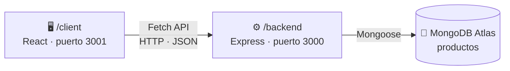

<div align="center">

# 🪑 Mueblería Hermanos Jota

### E-commerce full stack · React + Node.js/Express + MongoDB

Proyecto de curso de **Desarrollo Full Stack**: un catálogo de muebles con frontend en React, una API REST en Express y persistencia en MongoDB Atlas.


[Descripción](#-descripción) •
[Publicado](#-proyecto-publicado) •
[Arquitectura](#-arquitectura) •
[Instalación](#-instalación-y-ejecución) •
[Funcionalidades](#-funcionalidades-principales) •
[API](#-documentación-de-la-api) •
[Administración](#-administración-y-seguridad) •
[Decisiones](#-decisiones-de-arquitectura)

</div>

---

## 📖 Descripción

**Mueblería Hermanos Jota** es un e-commerce desarrollado como proyecto de un curso de Desarrollo Full Stack. Es un **monorepo** que reúne en un mismo repositorio:

- 🖥️ **`/client`**: el frontend, desarrollado con React mediante Create React App.
- ⚙️ **`/backend`**: la API REST, desarrollada con Node.js + Express, con persistencia en MongoDB Atlas mediante Mongoose.

El frontend consume el catálogo de productos que expone la API y permite explorarlo, ver el detalle de cada producto, agregarlo al carrito y enviar un formulario de contacto. Además, incluye una sección de Administración para crear, editar y eliminar productos.

---

## 👥 Integrantes

| Integrante |
|:-----------|
| Lautaro Iturrieta |
| Evelyn Noya Fraga |
| Matheo Dougan |

---

## 🌐 Proyecto publicado

| Servicio | Plataforma | Enlace |
|:---------|:-----------|:-------|
| 🖥️ Frontend | Vercel | [muebleria-hermanos-jota-client.vercel.app](https://muebleria-hermanos-jota-client.vercel.app) |
| ⚙️ Backend | Render | [muebleria-hermanos-jota-scrd.onrender.com](https://muebleria-hermanos-jota-scrd.onrender.com) |
| 📡 API de productos | Render | [/api/productos](https://muebleria-hermanos-jota-scrd.onrender.com/api/productos) |

> ⏳ El backend se aloja en el plan gratuito de Render: tras un período de inactividad, la primera respuesta puede tardar unos segundos.

---

## 🧰 Tecnologías

<table>
  <tr>
    <th align="left">🖥️ Frontend (<code>/client</code>)</th>
    <th align="left">⚙️ Backend (<code>/backend</code>)</th>
    <th align="left">☁️ Despliegue</th>
  </tr>
  <tr>
    <td valign="top">
      <ul>
        <li>React 19</li>
        <li>Create React App / react-scripts</li>
        <li>React Router</li>
        <li>JavaScript</li>
        <li>HTML5</li>
        <li>CSS3</li>
        <li>Fetch API</li>
      </ul>
    </td>
    <td valign="top">
      <ul>
        <li>Node.js</li>
        <li>Express 5</li>
        <li>MongoDB Atlas</li>
        <li>Mongoose</li>
        <li>CORS</li>
        <li>Dotenv</li>
        <li>Nodemon</li>
        <li>ES Modules</li>
      </ul>
    </td>
    <td valign="top">
      <ul>
        <li>Vercel (frontend)</li>
        <li>Render (backend)</li>
        <li>MongoDB Atlas (base de datos)</li>
      </ul>
    </td>
  </tr>
</table>

---

## 🏗️ Arquitectura

El proyecto está organizado como un monorepo con dos aplicaciones independientes que se comunican por HTTP. React consume la API REST, Express procesa las solicitudes, Mongoose consulta y modifica los documentos y MongoDB Atlas almacena los productos de forma persistente.



| Aplicación | Carpeta | Puerto local | Rol |
|:-----------|:--------|:------------:|:----|
| Frontend | `/client` | `3001` | Interfaz de usuario en React |
| Backend | `/backend` | `3000` | API REST del catálogo de productos |
| Base de datos | — | — | MongoDB Atlas, accedida mediante Mongoose |

---

## 📁 Estructura de carpetas

```text
/
├── client/                         # Frontend React
│   ├── public/
│   └── src/
│       ├── components/
│       │   ├── AdminAccessGuard.js
│       │   ├── AdminKeyProvider.js
│       │   ├── ContactForm.js
│       │   ├── Footer.js
│       │   ├── Navbar.js
│       │   ├── ProductCard.js
│       │   ├── ProductDetail.js
│       │   ├── ProductForm.js
│       │   └── ProductList.js
│       ├── pages/
│       │   ├── CatalogPage.js
│       │   ├── ContactPage.js
│       │   ├── CreateProductPage.js
│       │   ├── EditProductPage.js
│       │   ├── HomePage.js
│       │   └── ProductDetailPage.js
│       ├── App.js
│       └── index.js
│
└── backend/                        # API REST con Express
    ├── config/
    │   └── db.js                  # Conexión a MongoDB Atlas
    ├── models/
    │   └── Product.js             # Modelo de productos con Mongoose
    ├── middlewares/
    │   ├── errorHandler.js
    │   ├── logger.js
    │   └── notFound.js
    ├── routes/
    │   └── productos.routes.js
    ├── index.js
    └── package.json
```

---

## 🚀 Instalación y ejecución

> El frontend y el backend se ejecutan en **terminales separadas**. Para ver el catálogo en el cliente, ambos deben estar corriendo.

### Requisitos

- Node.js `>= 18`
- npm `>= 9`
- Una base de datos en MongoDB Atlas y su cadena de conexión

### 1️⃣ Backend — puerto `3000`

En la **Terminal 1**, seguí este orden:

**1. Instalá las dependencias**

```bash
cd backend
npm install
```

**2. Configurá el archivo `.env`**

Creá un archivo `.env` dentro de `/backend` y reemplazá los valores de ejemplo por los tuyos:

```env
PORT=3000
MONGO_URI=tu_cadena_de_conexion
ADMIN_API_KEY=tu_clave_de_api
ADMIN_ACCESS_PASSWORD=tu_contrasena_de_acceso
```

**3. Iniciá el servidor**

Recién después de instalar las dependencias y configurar el `.env`:

```bash
npm run dev
```

También puede ejecutarse con `npm start`.

### 2️⃣ Frontend — puerto `3001`

En la **Terminal 2**:

```bash
cd client
npm install
npm start
```

Creá un archivo `.env` dentro de `/client` con la URL de la API:

```env
REACT_APP_API_URL=http://localhost:3000/api/productos
```

> 🔒 No subas credenciales reales al repositorio: los archivos `.env` deben mantenerse fuera del control de versiones.

---

## ✨ Funcionalidades principales

### 🖥️ Frontend

- 📦 Catálogo de productos obtenido desde la API (`GET /api/productos`).
- ⭐ Productos destacados.
- 🔄 Manejo de estados de **loading**, **error** y **success**.
- 🗂️ Renderizado de productos mediante `.map()` y `key`.
- 🔍 Página de detalle de producto.
- 🧭 Navegación entre páginas con **React Router**.
- 🛒 Carrito de compras: agregar productos y contador en el `Navbar`.
- 📝 Formulario de contacto controlado mediante `useState`.
- ➕ Formularios para **crear** y **editar** productos.
- 🗑️ Eliminación de productos.
- 🔐 Acceso a Administración desde el menú.
- 📱 Diseño responsive.

**Componentes principales**

| Componente | Componente | Componente |
|:----------:|:----------:|:----------:|
| `Navbar` | `ProductList` | `ContactForm` |
| `Footer` | `ProductCard` | `ProductDetail` |

### ⚙️ Backend

- 🩺 Endpoint de verificación del estado de la API.
- 🍃 Conexión con **MongoDB Atlas** y modelos de **Mongoose**.
- 💾 Persistencia de productos.
- 🔁 Operaciones **CRUD** completas sobre el catálogo.
- 🚫 Respuesta HTTP 404 para productos inexistentes y para rutas no definidas.
- 🧾 Logging de método y URL de cada request.
- 🛡️ Manejo centralizado de errores.
- 🔐 Protección de las operaciones administrativas (ver [Administración y seguridad](#-administración-y-seguridad)).

---

## 📡 Documentación de la API

**URL base local:** `http://localhost:3000` · **URL publicada:** `https://muebleria-hermanos-jota-scrd.onrender.com`

| Método | Endpoint | Función | Autorización |
|:------:|:---------|:--------|:-------------|
| `GET` | `/` | Comprueba que la API está funcionando | Pública |
| `GET` | `/api/productos` | Obtiene todos los productos | Pública |
| `GET` | `/api/productos/:id` | Obtiene un producto por su identificador | Pública |
| `POST` | `/api/productos` | Crea un producto | Requiere `x-admin-key` |
| `PUT` | `/api/productos/:id` | Actualiza un producto | Requiere `x-admin-key` |
| `DELETE` | `/api/productos/:id` | Elimina un producto | Requiere `x-admin-key` |
| `POST` | `/api/admin/verificar-acceso` | Verifica la contraseña para acceder a Administración | Recibe `contrasena` en el cuerpo JSON |

> Los productos utilizan el identificador `_id` generado por MongoDB, no identificadores numéricos.

<details>
<summary><b><code>GET /</code></b> — Verificación de la API</summary>

<br>

```bash
curl http://localhost:3000/
```

**Respuesta `200`**

```json
{ "mensaje": "API Mueblería Jota funcionando" }
```

</details>

<details>
<summary><b><code>GET /api/productos</code></b> y <b><code>GET /api/productos/:id</code></b> — Consulta de productos</summary>

<br>

```bash
# Listado completo
curl http://localhost:3000/api/productos

# Un producto por su _id
curl http://localhost:3000/api/productos/ID_DEL_PRODUCTO
```

**Respuesta `200`** (respuesta simplificada)

```json
{
  "_id": "<_id>",
  "nombre": "Sofá Patagonia",
  "categoria": "Living",
  "precio": 185000,
  "destacado": true
}
```

> Respuesta simplificada: el documento completo incluye además otros campos del modelo. El listado devuelve una colección de productos con esta forma.

**Respuesta `400`** (identificador con formato inválido)

```json
{ "error": "Identificador de producto inválido" }
```

**Respuesta `404`** (producto inexistente)

```json
{ "error": "Producto no encontrado" }
```

</details>

<details>
<summary><b><code>POST</code> · <code>PUT</code> · <code>DELETE</code> <code>/api/productos</code></b> — Operaciones administrativas</summary>

<br>

Estas operaciones requieren la cabecera `x-admin-key` con el valor de `ADMIN_API_KEY`.

```bash
# Crear
curl -X POST http://localhost:3000/api/productos \
  -H "Content-Type: application/json" \
  -H "x-admin-key: tu_clave_de_api" \
  -d '{
    "nombre": "Sofá Patagonia",
    "descripcion": "Sofá de tres cuerpos",
    "precio": 185000,
    "stock": 5
  }'

# Editar
curl -X PUT http://localhost:3000/api/productos/ID_DEL_PRODUCTO \
  -H "Content-Type: application/json" \
  -H "x-admin-key: tu_clave_de_api" \
  -d '{ "precio": 190000 }'

# Eliminar
curl -X DELETE http://localhost:3000/api/productos/ID_DEL_PRODUCTO \
  -H "x-admin-key: tu_clave_de_api"
```

**Campos de creación**

| Campo | Obligatorio |
|:------|:-----------:|
| `nombre` | Sí |
| `precio` | Sí |
| `descripcion` | No |
| `stock` | No |
| `imagenUrl` | No |

</details>

<details>
<summary><b><code>POST /api/admin/verificar-acceso</code></b> — Acceso a Administración</summary>

<br>

Recibe `contrasena` en el cuerpo JSON y la comprueba en el backend contra `ADMIN_ACCESS_PASSWORD`. Se utiliza para habilitar la interfaz de Administración.

```bash
curl -X POST http://localhost:3000/api/admin/verificar-acceso \
  -H "Content-Type: application/json" \
  -d '{ "contrasena": "tu_contrasena_de_acceso" }'
```

</details>

<details>
<summary><b>Ruta inexistente</b> — Cualquier path no definido</summary>

<br>

```bash
curl http://localhost:3000/ruta-que-no-existe
```

**Respuesta `404`**

```json
{ "error": "Ruta no encontrada" }
```

</details>

---

## 🔐 Administración y seguridad

El proyecto utiliza dos variables de entorno independientes:

| Variable | Función |
|:---------|:--------|
| `ADMIN_ACCESS_PASSWORD` | Contraseña para acceder a la interfaz de Administración. Se verifica en el backend mediante `POST /api/admin/verificar-acceso`. |
| `ADMIN_API_KEY` | Protege las operaciones `POST`, `PUT` y `DELETE` de productos mediante la cabecera `x-admin-key`. |

> ⚠️ Es una **protección básica** pensada para este proyecto académico. No constituye un sistema de autenticación completo: no incluye usuarios registrados ni sesiones seguras.

---

## 🧠 Decisiones de arquitectura

| Decisión | Detalle |
|:---------|:--------|
| **Monorepo** | `/client` y `/backend` conviven en un mismo repositorio como aplicaciones separadas, cada una con su propio `package.json`, instalación y puerto. |
| **Persistencia en MongoDB Atlas** | Los productos se almacenan en MongoDB Atlas y se acceden mediante modelos de Mongoose, reemplazando los datos en memoria de la versión inicial. |
| **API con `express.Router`** | Las rutas del catálogo se definen en `routes/productos.routes.js` y se montan desde `index.js`. |
| **Middlewares dedicados** | Logging de método y URL, middleware 404 y middleware centralizado de errores, cada uno en su propio archivo dentro de `middlewares/`. |
| **`express.json()`** | La API incorpora el parseo de JSON como middleware. |
| **ES Modules** | El backend utiliza ES Modules. |
| **Configuración por variables de entorno** | La conexión a la base de datos y las claves de administración se definen en archivos `.env` mediante Dotenv, fuera del código. |
| **Protección básica de operaciones administrativas** | Contraseña de acceso verificada en el backend y clave de API en la cabecera `x-admin-key` para crear, editar y eliminar productos. |
| **Navegación con React Router** | El frontend se organiza en páginas, como la de detalle de producto, mediante rutas. |
| **Estados de la petición** | El frontend contempla los estados de loading, error y success al consumir la API. |
| **Despliegue separado** | Frontend en Vercel, backend en Render y base de datos en MongoDB Atlas. |

---

## 📜 Scripts disponibles

### Frontend (`/client`)

| Comando | Descripción |
|:--------|:------------|
| `npm start` | Inicia el frontend en modo desarrollo (puerto `3001`) |
| `npm test` | Ejecuta los tests |
| `npm run build` | Genera el build de producción |

### Backend (`/backend`)

| Comando | Descripción |
|:--------|:------------|
| `npm run dev` | Modo desarrollo con Nodemon: reinicia al guardar (puerto `3000`) |
| `npm start` | Ejecuta el servidor directamente con Node |

---

<div align="center">

Proyecto desarrollado por **Lautaro Iturrieta**, **Evelyn Noya Fraga** y **Matheo Dougan**
como parte de un curso de Desarrollo Full Stack.

</div>
